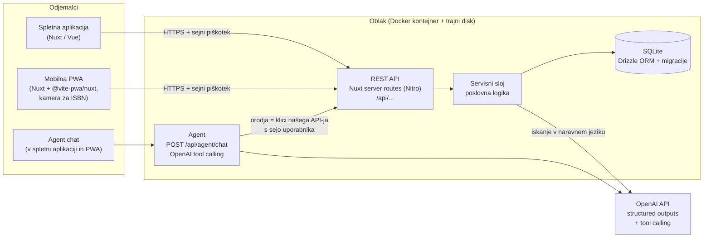
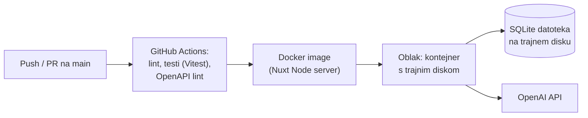

# Arhitektura

Shelfie je ena **Nuxt** aplikacija: Vue frontend (spletna aplikacija in PWA) in Nitro strežnik (REST API) v istem repozitoriju. Podatki so v **SQLite** prek **Drizzle ORM**, AI funkcionalnosti uporabljajo **OpenAI**. Odločitev in alternative: [0001-stack.md](decisions/0001-stack.md).

## Komponente

## Sloji (strežnik)
- **Predstavitev:** `server/api/**` — Nitro route handlerji; samo validacija vhoda (Zod), DTO-ji in klic servisa.
- **Poslovna logika:** `server/services/**` — izposoje, rezervacije, čakalna vrsta, pravila podaljševanja, avtorizacija po vlogi in lastništvu. Transakcije za operacije, ki spreminjajo več tabel.
- **Dostop do podatkov:** `server/db/**` — Drizzle shema, poizvedbe, migracije (`drizzle-kit`).
- **AI:** `server/ai/**` — LLM iskanje (shema izhoda + validacija) in agent (definicije orodij, potrditveni korak, omejitev korakov, beleženje).
- **Frontend:** `app/pages`, `app/components` — Vue strani za člane, skrbnike in administratorje; ista koda služi kot PWA.

## Avtentikacija in avtorizacija
- Prijava z e-pošto in geslom; seja v šifriranem piškotku `httpOnly` (npr. `nuxt-auth-utils`). Ker sta spletna aplikacija in PWA na isti domeni, uporabljata isti mehanizem.
- Vloga se določi iz `MEMBERSHIP` za knjižnico v zahtevi (`/api/libraries/:libraryId/...`).
- Preverjanje vloge **in** lastništva v servisnem sloju (npr. član lahko podaljša samo svojo izposojo), nikoli samo na frontendu.
- Agent kliče API z uporabnikovo sejo, zato ima natanko iste pravice kot uporabnik.

## Postavitev (deployment)

- Aplikacija teče kot Node strežnik (`nuxt build`) v Docker kontejnerju pri ponudniku s trajnim diskom (kandidata: Fly.io, Azure App Service / Container Apps). Končna izbira v ADR za postavitev (teden 8).
- Migracije se izvedejo ob zagonu (`drizzle-kit migrate`).
- Skrivnosti (`OPENAI_API_KEY`, `NUXT_SESSION_PASSWORD`) so v okoljskih spremenljivkah ponudnika in GitHub Secrets, nikoli v repozitoriju.
- Health check: `GET /api/health`.
