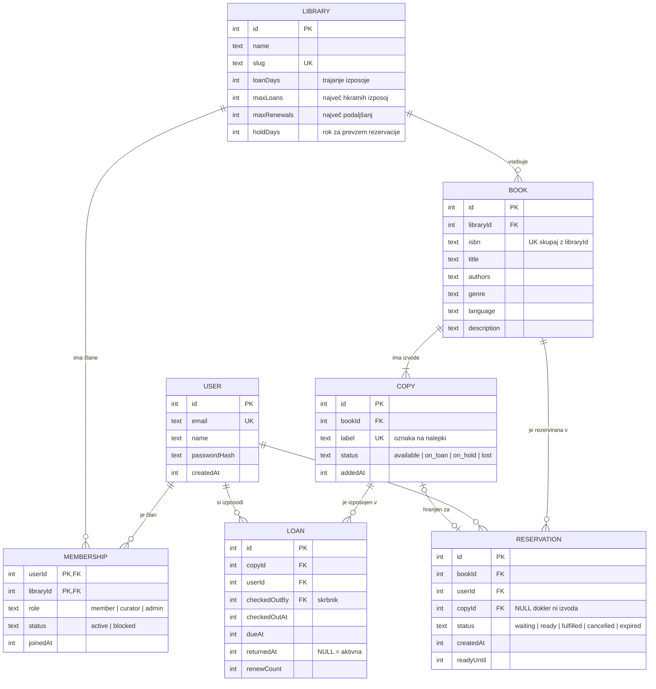

# Podatkovni model

Baza: **SQLite** prek **Drizzle ORM** (sheme v `server/db/schema.ts`, spremembe samo z migracijami `drizzle-kit`). Datumi so shranjeni kot časovni žigi (integer), enumi kot `text` s preverjanjem vrednosti.

## Relacije
- **M:N** `USER` ↔ `LIBRARY` prek povezovalne entitete **`MEMBERSHIP`**, ki ima lastne podatke (vloga, status, datum včlanitve). Vloga velja za posamezno knjižnico.
- **1:N** `LIBRARY` → `BOOK`, `BOOK` → `COPY`, `COPY` → `LOAN`, `BOOK` → `RESERVATION`.
- `LOAN` in `RESERVATION` sta tudi zgodovinski povezavi med uporabnikom in izvodom/knjigo z lastnimi podatki (roki, število podaljšanj, stanje).

## Entitete

| Entiteta | Opis | Pomembna pravila / omejitve |
|----------|------|-----------------------------|
| USER | Uporabniški račun | `email` unikaten |
| LIBRARY | Ena knjižnica (dom, društvo, klub) s svojimi pravili izposoje | `slug` unikaten; pravila > 0 |
| MEMBERSHIP | Članstvo uporabnika v knjižnici z vlogo | PK (`userId`, `libraryId`); `role` ∈ {member, curator, admin}; vsaj en admin na knjižnico |
| BOOK | Naslov v katalogu knjižnice | (`libraryId`, `isbn`) unikatno |
| COPY | Fizični izvod knjige na polici | `status` se spreminja samo prek izposoje, vračila in rezervacij |
| LOAN | Izposoja izvoda članu | največ ena aktivna izposoja (`returnedAt` NULL) na izvod |
| RESERVATION | Mesto člana v čakalni vrsti za knjigo | največ ena aktivna rezervacija (`waiting`/`ready`) na člana in knjigo; vrstni red po `createdAt` |

## Poslovna pravila
1. Član si lahko izposodi izvod le, če ima manj kot `maxLoans` aktivnih izposoj, nima nobene izposoje z zamudo in njegovo članstvo ni `blocked`.
2. Rok vračila = trenutek izposoje + `loanDays`; podaljšanje ga premakne za `loanDays`.
3. Podaljšanje je dovoljeno le, če `renewCount < maxRenewals`, izposoja ni v zamudi in za knjigo nihče ne čaka (`waiting`).
4. Rezervacija je mogoča le, če ni razpoložljivega izvoda, član knjige nima izposojene in še ni v vrsti.
5. Ob vračilu izvoda, če obstaja rezervacija `waiting`: izvod dobi stanje `on_hold`, najstarejša rezervacija postane `ready` z `readyUntil = zdaj + holdDays`. Izvod `on_hold` lahko prevzame samo ta član.
6. Rezervacija `ready`, ki ni prevzeta do `readyUntil`, preide v `expired`; izvod gre naslednjemu v vrsti ali postane `available`.
7. Izvoda s statusom `on_loan` ali `on_hold` ni mogoče izbrisati.

## Pokritost Must zgodb
| Zgodba | Entitete |
|--------|----------|
| 1 iskanje | BOOK, COPY (štetje razpoložljivih) |
| 2 upravljanje zbirke | BOOK, COPY, MEMBERSHIP (vloga) |
| 3 izposoja/vračilo | LOAN, COPY, MEMBERSHIP (blokada), LIBRARY (pravila), RESERVATION |
| 4 moje izposoje | LOAN, USER |
| 5 rezervacije | RESERVATION, COPY, LIBRARY (`holdDays`) |
| 9 skeniranje ISBN | BOOK (`isbn`), COPY |
| 10 iskanje v naravnem jeziku | BOOK (`genre`, `language`, `description`) |
| 11 agent | BOOK, COPY, LOAN, RESERVATION (prek API-ja) |
